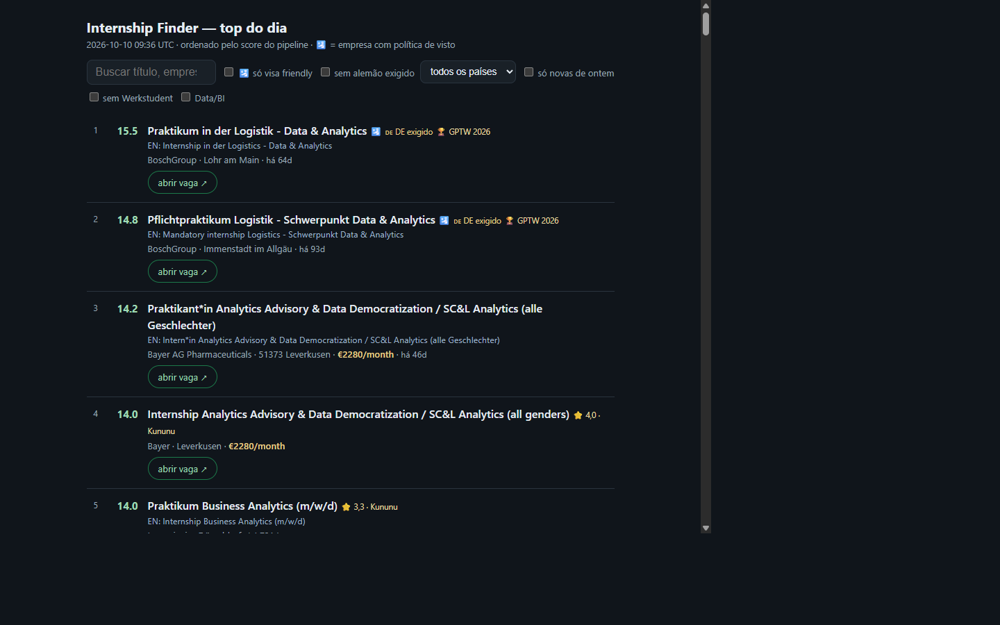
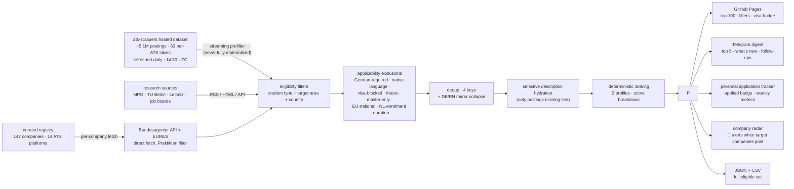

# internship-finder

**A production data pipeline that streams ~5.1 million job postings every
day, deduplicates them across sources and languages, and publishes a
ranked, visa-aware shortlist of internships and working-student jobs in
Germany — rebuilt and re-ranked every morning at 09:00 UTC since
September 2026.**

[](https://github.com/rios-vini/internship-finder/actions/workflows/ci.yml)
[](https://www.python.org/)
[](LICENSE)
[](https://rios-vini.github.io/internship-finder/)
[](https://rios-vini.github.io/internship-finder/rss.xml)

**→ Live ranking, refreshed every morning at 09:00 UTC:
[rios-vini.github.io/internship-finder](https://rios-vini.github.io/internship-finder/)**



---

## The problem

One person, one profile: a Materials Engineering student from Brazil
looking for a **procurement / supply chain internship in Germany** for
early 2027. Germany posts these roles as *Praktikum* and *Werkstudent*
scattered across dozens of ATS platforms (Workday, SuccessFactors,
SmartRecruiters, EURES, the Bundesagentur für Arbeit, and more), often
German-only, duplicated across platforms and languages, with no signal
for which employers actually hire non-EU candidates.

Job boards show you everything. I needed the opposite: a short, ranked,
deduplicated list of the few postings that fit one specific profile,
waiting for me every morning. So I built the funnel I couldn't find.

## Yesterday's funnel (run 2026-10-12, 09:00 UTC)

Real numbers from the production run — nothing staged for the README:

```text
126,842  postings collected (all sources)
   ↓
  3,094  pass the eligibility filters
         (student-type roles · target areas · target countries)
   ↓
  -2,104  excluded by applicability rules
          (1,195 German-required · 744 pure Werkstudent · 68 visa-blocked
           · 56 master-required · 41 thesis titles)
   ↓
    990  applicable postings
   ↓
   -207  duplicates removed
         (4 dedup keys + DE/EN mirror collapse)
   ↓
    783  eligible → ranked by 2 independent profiles → top 100 published
```



## How it works

A cron job on an Oracle Linux VPS runs the full pipeline once a day and
has done so in production since September 2026.

**Sources.** Three ingestion paths feed one normalized stream:

- **Hosted dataset** — ~5.1M postings from the upstream
  [`ats-scrapers`](https://github.com/kalil0321/ats-scrapers) dataset
  (63 per-ATS slices, refreshed daily ~14:30 UTC), consumed by a
  **streaming line-by-line prefilter** — a slice is never fully
  materialized in memory or on disk beyond the active CSV.
- **Curated registry** — 147 companies across 14 ATS platforms, fetched
  per company, plus direct daily samples from the **Bundesagentur für
  Arbeit API** (facet code 34 = Praktikum/Trainee) and **EURES**
  (Praktikum keyword, description included by the search API).
- **Research sources** — Max Planck Society, TU Berlin, Leibniz
  association, plus keyless job boards.

**Eligibility.** Student-type roles (*Praktikum*, *Werkstudent*,
internship, working student) in Supply Chain / Procurement / BI /
Analytics, in Germany (primary, ~74% of the current eligible volume)
plus Luxembourg, Netherlands, Finland and Belgium. **Applicability** then removes
postings that are technically eligible but not applicable to one
specific candidate (German-required, native-language requirements,
EU-national-only, Dutch-university enrollment, **EU-university enrollment**,
German-university enrollment, master-level targets,
recent-graduate targets, >6-month durations, visa-blocked, thesis titles,
pure Werkstudent, prior-experience requirements) — each exclusion reason is counted and
logged, never silently dropped. Postings whose hydrated description later
reveals a hard-eligibility hit (`native_language`, `duration_conflict`,
`recent_graduate`, `german_required`, `job_type_non_internship`,
`experience_required`) are removed from the eligible JSON entirely; the
remaining reasons keep the posting with a 🚫 inapplicable badge, demoted
from the displayed top.

**Dedup.** Five independent keys in the classic cascade (canonical URL with tracking params
stripped, platform id, normalized title+company+location, DE/EN translation of
title+city, BA/EURES mirror by base64 reference) plus a **cross-ATS mirror** tier
for known mirrored source pairs (e.g., jobs.lidl via SuccessFactors dataset
↔ praktikum.info): when two curated sources mirror the same employer, a
(normalized title × canonical company) key collapses them without needing
matching ids or locations. The registry's wildcard "mehrere Standorte"
postings are collapsed against their concrete-city twins, and a mirror
collapse keyed on requisition id merges DE/EN mirrors on the same tenant.

**Selective hydration.** Postings that arrive without a description get
one, fetched individually from the ATS (detail endpoints verified for
workday, smartrecruiters, eightfold and personio; the mirrored BA/EURES
and the wildcards "mehrere Standorte" feed the DE/EN collapse) — on the
2026-10-12 run: 241 candidates, 162 fetched, description coverage
542/783 → 704/783 (90%). Best-effort and budget-capped; a failure per
posting never affects the run.

**Assessability & liveness at intake.** Two guardrails keep the owner's
manual analysis focused on postings worth analyzing. (a) Postings whose
description can't support a judgment — empty (JS-only sources), under a
measured 600-char threshold (login-wall fragments) or matching
login-wall/placeholder patterns — carry a `not_assessable` flag shown as
a ⚠️ badge on the page and one aggregate line in the Telegram digest; it
is a signal, never an exclusion, and successful hydration clears it.
(b) Brand-new postings (first appearance of the id vs the previous
snapshot) get one cheap liveness fetch *before* entering the analysis
window: a confirmed 404/410 is removed via the dead-link mechanism, and
a fake-200 that announces the position was filled ("Diese Stelle wurde
leider bereits besetzt") is treated as dead for display. Network
timeouts never prove death, and the whole stage is budget-capped on the
same daily fetch budget as hydration (off by default). (c) Everything
the machine can't judge — non-assessable/borderline postings, `unknown`
liveness verdicts and provider-ID collisions between dead and alive
companies (a `recruitee` id reused by another employer) — lands in one
regenerated `data/MANUAL-CHECK.md` queue: one line per item with a
direct link (redirect chains resolved to their final target), the
reason and the first-sighting date. The queue is parallel: nothing
leaves the ranking or the Top-5.

**Temporal eligibility (F95/F109).** Every posting is scanned for its
declared start window: German semesters (SoSe/WiSe), explicit date
ranges, "ab <Month> <Year>" patterns, and "ab sofort" with context
(F67). The canonical window is compared against the owner's availability
(Jan–Sep 2027 per §16e visa) and flagged **display-only** as:
`TOO_EARLY` (before Jan 2027), `IMMEDIATE` (ab sofort with context or
ASAP formulas), `TOO_LATE` (after Sep 2027). **F109 adds `start_date_ambiguous`**:
"ab <Month>" **without a year** (e.g. Lidl's "Ab August / September") gets
its own flag — never decides TOO_EARLY/TOO_LATE because the year is
unknown; the badge shows the months (e.g. "início ambíguo: ago/set — jan/2027?").
Corpus measurement: 777 postings with "ab <Month>" no year. The IMMEDIATE
flag already fires on 5/6 recurring Lidl "Ab sofort" repostings (the 6th
has no description).

**Ranking.** Deterministic, reproducible scoring (no ML) over the same
eligible set, with a full per-component breakdown; ties broken by score
→ title → company → id. Two independent profiles rank it: the primary
**Procurement / Supply Chain** view and a secondary **Materials
Engineering** view. Before any weight change, the ranking is measured
against a versioned benchmark: 59 real postings labeled by hand, ordinal
agreement **Kendall tau +0.651** (`docs/ranking_benchmark.md`,
`benchmarks/ranking_benchmark_v1.json`).

**Outputs.** GitHub Pages (top 100 with client-side search, filters and
a 🛂 visa-friendly badge), a Telegram daily digest (top 5, what's new,
tracker follow-up reminders), a personal application tracker (applied
badge, weekly funnel metrics), a candidature log with reply cadence
(`templates/registro_candidaturas.md` + `scripts/reply_tracking.py`:
Sent/Interview/Offer/Rejected/Responded statuses, nudge at +7d, ping at
+14d, close at +28d, and a 30-day company-wide rejection guard that
expires — a past rejection never permanently blocks an employer; the
owner's holistic 1–5 score and APLICAR/VALE/OVERRIDE/CONTRA verdict are
owner-only columns — the LLM never ranks or decides), a company radar
(🎯 alerts when watched companies post), the full JSON/CSV set — and,
before any cover letter is reused between same-employer postings, an
offline JD-similarity check (`scripts/jd_similarity.py`) that answers
*reuse / reuse_with_edits / regenerate* and lists the topics the letter
must cite.

## Engineering principles

- **Deterministic-first.** Re-running the pipeline on the same input
  produces byte-identical output (verified by sha256 on every A/B).
  Ranking is pure scoring, no ML, no hidden state.
- **LLM informs, never decides.** The one LLM component (field
  enrichment with textual evidence) is a kill-switched, budget-capped
  stage that proposes fields with quotes from the posting; eligibility,
  ranking and publication are 100% deterministic and never read LLM
  output. In production it runs with the env gate OFF by default.
- **A/B before every merge.** Each feature PR proves that unchanged
  paths produce byte-identical outputs on the same input, and CI must
  pass twice on the exact merge SHA. Production data is never touched
  by experiments.
- **Benchmark before touching weights.** The ranking benchmark is
  versioned in-repo, re-runnable, and must be measured before and after
  any scoring change.
- **Kill switches everywhere.** Every optional stage is default-OFF or
  flag-reversible: `--no-dedup`, `--no-mirror-dedup`,
  `--no-hydrate-descriptions`, `--no-applicability`, `--official-page`
  (off), LLM enrichment (env-gated, off). Dead components get their
  default flipped off rather than deleted — measured decision, with the
  reasoning in the docs.
- **One gate to production.** The public page goes through a single
  publication gate: secret scanning (zero matches for tokens and server
  paths), atomic writes, and a failure mode that keeps yesterday's site
  online.
- **SQLite with a lifecycle.** Single-writer discipline, archive
  rotation before every run (rollback = copy back), and a backup suite
  in CI.
- **Upstream contributions.** Fixes found while building this went back
  to [`ats-scrapers`](https://github.com/kalil0321/ats-scrapers), the
  library this project builds on.

## By the numbers

All figures from the run of **2026-10-12** unless marked otherwise;
sources are files in this repo.

| | |
|---|---|
| **~5.1M** | job postings streamed daily from the upstream dataset (`docs/historico/f3_sf_dataset.md`) |
| **126,842 → 783** | postings collected → eligible, run 2026-10-12 (production metrics, snapshot in `docs/historico/PROJECT_STATUS.md` and the metrics JSONL) |
| **147 / 14** | curated companies / ATS platforms in the registry (`src/internship_finder/registry.py`) |
| **5** | target countries: Germany (primary) + LU, NL, FI, BE |
| **149** | CI test suites, all green on every push and pull request (`.github/workflows/ci.yml`) |
| **+0.651** | Kendall tau vs. a 59-job human-labeled ranking benchmark (`docs/ranking_benchmark.md`) |
| **227** | commits, one feature PR per change (git log, first-parent) |

**F112 (2026-10-24)** — GO/NO-GO measurement for blind hydration extension:
- **arbeitsagentur (MTU 7×, refnr 12951-*)**: NO-GO — 7/7 pages return HTTP 200 soft-404 (homepage, no JobPosting JSON-LD)
- **KPMG portal (4×, jobs.kpmg.de)**: NO-GO — 4/4 pages return SuccessFactors SPA shell (JS-heavy, no JobPosting JSON-LD, no "Sehr gute Deutschkenntnisse" phrase)
- Result: `BLIND_HYDRATION_SOURCES` unchanged (`absolventa`, `praktikum_info`), pattern F91 (bundesagentur 74/74 NO-GO)

## Tech stack

**Python 3.12+** stdlib-heavy · pydantic (canonical `Job` model) ·
sqlite3 · requests / BeautifulSoup · GitHub Actions (69 suites on a
clean runner, no network, no local data) · GitHub Pages · Telegram Bot
API · Oracle Linux VPS + cron. Zero frontend framework — the page is a
single self-contained HTML with vanilla JS.

## Quickstart

```bash
python3.12 -m venv .venv
.venv/bin/pip install -e .
.venv/bin/internship-finder            # filter + rank from data/jobs.json
```

Collect from the curated registry — the same command the daily cron
runs:

```bash
.venv/bin/internship-finder --registry --country de,lu,nl,fi,be
```

Every stage above is a flag: `--no-dedup`, `--no-hydrate-descriptions`,
`--no-applicability`, `--official-page`, `--direct-fetch`,
`--research-sources`. Run any subset, measure, compare.

## Testing

The standalone test suites run on every push (clean runner, Python 3.12,
no network, no local data). Each one prints `[OK]`/`[FAIL]` and exits
non-zero on failure:

```bash
python scripts/test_dedup.py
```

The ranking benchmark is re-runnable offline:

```bash
.venv/bin/python scripts/ranking_benchmark.py
```

## Documentation

- **[docs/README-operacional.md](docs/README-operacional.md)** — the full
  operational documentation: setup, cron, runbook, coverage tables, and
  the daily-refresh workflow (PT-BR, the repo's working language).
- **[docs/architecture.md](docs/architecture.md)** — the pipeline behind
  this README, stage by stage.
- **[docs/ranking_benchmark.md](docs/ranking_benchmark.md)** — the
  ranking benchmark: labels, methodology, tau, and how to re-run it.
- **[docs/](docs/)** — enrichment and design notes.
- **[docs/historico/](docs/historico/)** — the full project history:
  phase reports, audits, and decision logs from every stage of the build
  (PT-BR).

## Disclaimer

Personal, single-user project: the funnel is tuned to one candidate
profile by design, production data lives in a gitignored `data/`
directory (nothing versioned), and the "latest run" numbers in this
README are snapshots of the day they were written — the live site always
shows the current one.

---

## Resumo (PT-BR)

Pipeline pessoal de dados, em produção desde setembro de 2026: coleta
~5,1M de vagas por dia (dataset upstream + registry de 147 empresas +
APIs da Bundesagentur/EURES + fontes de pesquisa), filtra estágios
*Praktikum*/*Werkstudent* em procurement/supply chain na Alemanha (+ LU,
NL, FI, BE), remove inaplicáveis para um perfil específico, deduplica
com 4 chaves + colapso de espelhos DE/EN, hidrata descriptions
seletivamente e ranqueia com 2 perfis determinísticos — medidos contra
benchmark rotulado à mão (tau +0,651). Guardrails de análise: vagas sem
descrição avaliável ganham flag ⚠️ (sinal, nunca exclusão; hidratação
cura) e vagas novas passam por 1 liveness check no 1º sighting (404/410
ou "besetzt" 200-falso = morta antes de gastar análise; timeout nunca
mata; budget diário compartilhado com a hidratação); o que a máquina
não consegue julgar (não-avaliável/borderline, liveness unknown, ID de
provedor colidindo entre empresa viva e morta) vira fila diária
`data/MANUAL-CHECK.md` com link direto, motivo e data — fila paralela,
o Top-5 não é filtrado. Produtos: página
pública diária (GitHub Pages), digest no Telegram, tracker pessoal de
candidaturas, radar de empresas-alvo e registro de candidaturas com
cadência de followup (reply-tracking F98: status da resposta, nudge
+7d/ping +14d/encerra +28d, guard de 30d por empresa que VENCE —
rejeição antiga não é bloqueio eterno — e as colunas `score_1_5` +
`verdict` do DONO; o pipeline nunca decide veredito e o score 0–10
interno fica intocado). Documentação operacional
completa (PT-BR) em `docs/README-operacional.md`.

## License

[MIT](LICENSE) © 2026 Vinícius Rios
# CI trigger
# CI trigger
